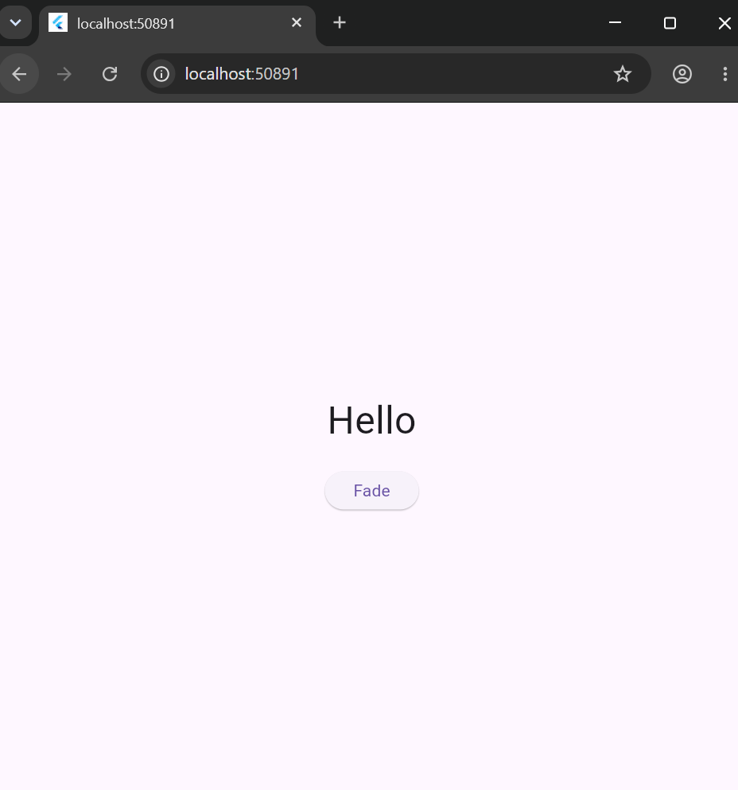

# Fade Demo

A Flutter demo of the AnimatedOpacity widget, which smoothly fades a widget in and out when a value changes.

## How to run

1. Install Flutter and make sure `flutter doctor` shows no major problems.
2. Clone the repo:
   git clone https://github.com/Melyssa-Ingabe/fade_demo.git
3. Go into the folder:
   cd fade_demo
4. Install packages:
   flutter pub get
5. Run the app in Chrome:
   flutter run -d chrome

## The three attributes

- opacity: how visible the child is. 1.0 is fully visible and 0.0 is invisible. In this demo it switches between the two using a boolean called visible.
- duration: how long the fade takes. Here it is one second.
- child: the widget being faded. Here it is the Text widget that says "Hello".

Pressing the Fade button calls setState, which flips visible. AnimatedOpacity then animates to the new opacity on its own, with no animation controller needed.

## Screenshot

